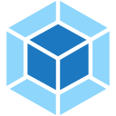

  

 

<h2 align="center">🔭 Currently</h2>

<table align="center">
<tr>
<td align="center" width="220"><h1>🧠</h1><b>Second brain</b> My main project right now</td>
<td align="center" width="220"><h1>🌱</h1><b>Learning</b> Something new every day</td>
<td align="center" width="220"><h1>⚡</h1><b>Tinkering</b> Ideas, tools &amp; side projects</td>
</tr>
</table>

 

<h2 align="center">🛠️ Tech Stack</h2>

<h3 align="center">💻 Languages</h3>
<table align="center"><tr>
<td align="center" width="110"> <b>Python</b></td>
<td align="center" width="110"> <b>Swift</b></td>
<td align="center" width="110"> <b>C</b></td>
<td align="center" width="110"> <b>C++</b></td>
<td align="center" width="110"> <b>PHP</b></td>
<td align="center" width="110"> <b>JavaScript</b></td>
<td align="center" width="110"> <b>Bash</b></td>
</tr></table>

<h3 align="center">🎨 Front-end</h3>
<table align="center"><tr>
<td align="center" width="110"> <b>HTML5</b></td>
<td align="center" width="110"> <b>CSS3</b></td>
<td align="center" width="110"> <b>Sass</b></td>
<td align="center" width="110"> <b>Bootstrap</b></td>
<td align="center" width="110"> <b>Webpack</b></td>
<td align="center" width="110"> <b>Figma</b></td>
<td align="center" width="110"> <b>Photoshop</b></td>
</tr></table>

<h3 align="center">⚙️ Back-end & Data</h3>
<table align="center"><tr>
<td align="center" width="110"> <b>Symfony</b></td>
<td align="center" width="110"> <b>MySQL</b></td>
<td align="center" width="110"> <b>PostgreSQL</b></td>
</tr></table>

<h3 align="center">☁️ Tools & Infra</h3>
<table align="center"><tr>
<td align="center" width="110"> <b>Docker</b></td>
<td align="center" width="110"> <b>AWS</b></td>
<td align="center" width="110"> <b>Linux</b></td>
<td align="center" width="110"> <b>Git</b></td>
</tr></table>

 

